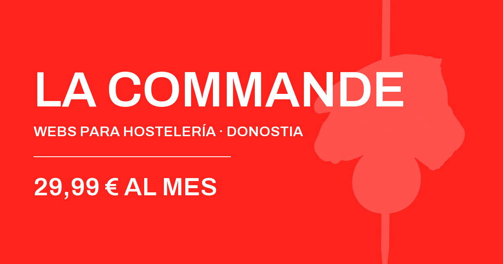

# La Commande

Website of **La Commande**, my own web design service for bars, restaurants and other local businesses in San Sebastián (Donostia), Spain.

**Live site:** https://la-commande.pages.dev

## What is in it

- 21 pages in Spanish, Basque and English: one page per kind of business (hospitality, hair and beauty, other local businesses), plans and prices, examples and contact, plus a 404 page, `robots.txt` and `sitemap.xml`.
- 16 demo websites in [`demos/`](demos/) for fictional businesses (a tavern, a café, a barbershop, a nail salon, a garage, a physiotherapy clinic…), so a business owner can open a working site before asking for one.

## Stack

Plain HTML, CSS and vanilla JavaScript, with no framework. The pages are generated by a Python script that lives outside this repository; this repository holds the built output, and Cloudflare Pages publishes every push to `main`.

The fishmonger and barbershop demos open with a short looping video. Cloudflare Pages serves static files whole, even when the browser asks for a byte range, and Safari won't play a video that way, so a small Pages Function in [`functions/`](functions/) serves each demo's videos in ranges (`206 Partial Content`). Each one runs for its own folder only.

## License

The code (HTML, CSS and JavaScript) is under the [MIT License](LICENSE). It does not cover:

- the La Commande name, logo and texts;
- the photographs in the demos, from Unsplash and Pexels, used under the Unsplash License and the Pexels License;
- the videos in the fishmonger and barbershop demos, from Pexels, used under the Pexels License and edited;
- the fonts, each under the SIL Open Font License 1.1.
